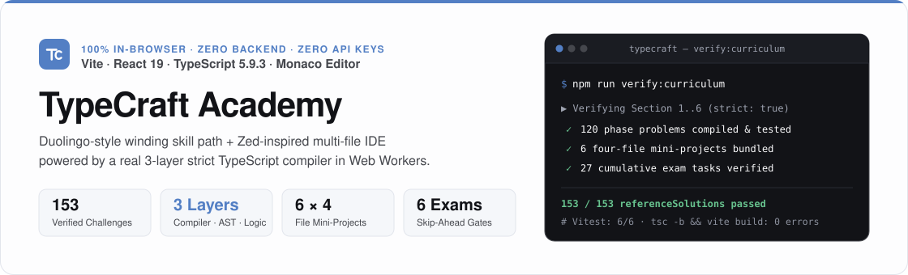
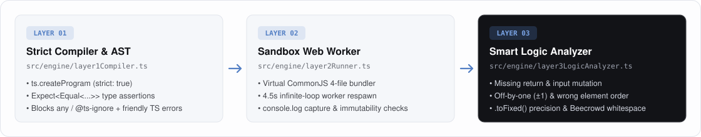

<div align="center">

<a href="https://htmlpreview.github.io/?https://github.com/athoskolling/TypeCraft/blob/main/README.html">
  
</a>

<br /><br />

[](https://www.typescriptlang.org/)
[](https://react.dev/)
[](https://microsoft.github.io/monaco-editor/)
[](#-curriculum-overview-153-verified-challenges)
[](https://htmlpreview.github.io/?https://github.com/athoskolling/TypeCraft/blob/main/README.html)

<p>
  <strong>100% In-Browser Interactive TypeScript Mastery Platform</strong> — combining a Duolingo-style winding skill path, a Zed-inspired multi-file IDE (<code>Zed One Dark</code> &amp; <code>Zed One Light</code>), and a real TypeScript 5.9 3-Layer Diagnostic Engine inside Web Workers with zero backend and zero API keys.
</p>

</div>

---

## Architecture · 3-Layer Diagnostic Engine

<p align="center">
  
</p>

Unlike static string-matching platforms, **any valid TypeScript solution passes**:

1. **Layer 1 — Strict TypeScript 5.9 Compiler & AST Verifier (`src/engine/layer1Compiler.ts`)**
   - Runs `ts.createProgram` in `strict: true` against bundled ES2023 `.d.ts` definitions (`src/engine/tsLibMap.json`) plus global type-challenge utilities (`Expect`, `Equal`, `ExpectTrue`, `ExpectFalse`, `NotEqual`, `IsAny`, `NotAny`, `Alike`).
   - Translates cryptic compiler diagnostics (`TS2322`, `TS2339`, `TS2344`, `TS2345`, `TS7006`, `TS2532`, `TS18046`, etc.) into clear educational explanations.
   - Enforces AST rules (`forbidExplicitAny`, `forbidTsIgnore`, `requireGenerics`, `requireTypeNarrowing`, `requireTypePredicate`, `requireClass`, `requireAsync`).

2. **Layer 2 — Sandbox Runner & Virtual CommonJS Bundler (`src/engine/layer2Runner.ts`)**
   - Executes inside an isolated Web Worker (`src/engine/sandbox.worker.ts`) with a **4.5s infinite-loop watchdog** that terminates and respawns hung workers without freezing the UI.
   - Bundles 4-file Mini-Projects virtually in-memory with cross-file `import`/`export` resolution, `console.log` capture, async `Promise` support, and `checkImmutability` input mutation guards.

3. **Layer 3 — Smart Logic Error Analyzer (`src/engine/layer3LogicAnalyzer.ts`)**
   - Automatically detects and explains forgotten `return` statements (`undefined`), in-place input mutations, off-by-one (`±1`) counts, `.toFixed()` precision drift, Beecrowd trailing whitespace/newline discrepancies, and wrong element ordering.

---

## Curriculum Overview (153 Verified Challenges)

Each of the **6 Sections** includes **5 Phases × 4 Problems (120 Phase Problems)** + **1 Multi-File Mini-Project (4 files each)** + **1 Cumulative Exam (27 Exam Tasks)** across three blended styles (`beecrowd`, `leetcode`, and `type-challenge`):

| Tier | Focus | 4-File Mini-Project | Cumulative Exam |
| :---: | :--- | :--- | :--- |
| **S1** | **Foundations, Control Flow & I/O** | *CLI Receipt, Discount & Tax Engine* (`types.ts`, `discounts.ts`, `taxes.ts`, `engine.ts`) | Exam 1 · S1 (4 tasks) |
| **S2** | **Functions, Strings & Arrays** | *Server Log Analyzer & CSV Pipeline* (`types.ts`, `parser.ts`, `aggregator.ts`, `pipeline.ts`) | Exam 2 · S1–S2 (4 tasks) |
| **S3** | **Objects, Interfaces, Unions & Narrowing** | *Task Workflow State Machine* (`types.ts`, `guards.ts`, `transitions.ts`, `machine.ts`) | Exam 3 · S1–S3 (4 tasks) |
| **S4** | **Generics & Data Structures** | *Typed LRU Cache & Query Engine* (`types.ts`, `lruCache.ts`, `queryEngine.ts`, `index.ts`) | Exam 4 · S1–S4 (5 tasks) |
| **S5** | **Classes, Architecture & Async TS** | *Async Job Queue & Rate Limiter* (`types.ts`, `rateLimiter.ts`, `retryPolicy.ts`, `jobQueue.ts`) | Exam 5 · S1–S5 (5 tasks) |
| **S6** | **Advanced Type-Level TS & Algorithms** | *Mini Schema Validator (`mini-zod`)* (`types.ts`, `primitives.ts`, `composites.ts`, `index.ts`) | Exam 6 · S1–S6 (5 tasks) |

### Skip-Ahead & Early Project Access
- Every locked section features **"Jump Here (Cumulative Exam)"** and **"Try Mini-Project Early"**.
- Passing a higher section's Cumulative Exam (with hints disabled) immediately unlocks that section and marks all preceding sections as **Tested Out** (still playable anytime).

---

## Zed IDE Ergonomics & Shortcuts

| Shortcut / Control | Action |
| :--- | :--- |
| **`Ctrl / Cmd + Enter`** | Compile strict TypeScript, check AST rules, and run all verification tests |
| **`Ctrl / Cmd + K`** | Open Zed Command Palette (search challenges, mini-projects, exams, themes) |
| **Bottom Dock** | Switch between *Test Results & Diagnostics*, *Console*, and *Custom Input / Playground* |
| **Local Persistence** | Auto-saves progress & code in `localStorage` with 1-click **Export/Import JSON** and Reset |

---

## Development & Verification Commands

```bash
# Install dependencies
npm install

# Launch local Vite dev server
npm run dev

# Run engine & state unit tests (Vitest)
npm test

# Compile & execute 100% of curriculum referenceSolutions & 4-file Mini-Projects
npm run verify:curriculum

# Type-check & build production bundle
npm run build
```

> Also available as a standalone interactive webpage in [`README.html`](./README.html) ([Live Rendered Preview](https://htmlpreview.github.io/?https://github.com/athoskolling/TypeCraft/blob/main/README.html)).
